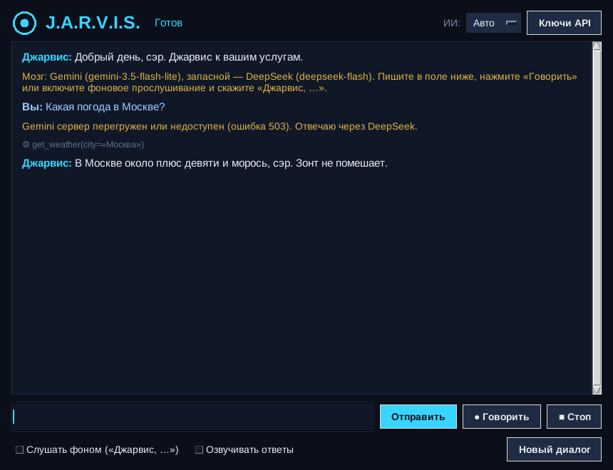

# J.A.R.V.I.S. — голосовой ассистент на Gemini и DeepSeek

Личный ассистент в стиле Джарвиса: управляет компьютером голосом и через чат.
Мозг — Google Gemini и/или DeepSeek (по вашим API-ключам) с вызовом функций. Если Gemini тормозит
или недоступен, ассистент сам переключается на DeepSeek. Голос — распознавание речи Google
и нейроголос Microsoft Edge.



## Что умеет

| Категория | Примеры фраз |
|---|---|
| Программы и окна | «открой Телеграм», «закрой хром», «переключись на блокнот», «сверни окно браузера», «какие программы открыты» |
| Браузер | «открой ютуб», «найди в гугле рецепт борща», «включи на ютубе лоу-фай», «найди в Яндексе…» |
| Звук и экран | «громкость 40», «сделай тише», «выключи звук», «яркость 70», «пауза», «следующий трек» |
| Клавиатура | «напечатай: привет, как дела», «нажми ctrl+s», «прокрути вниз», «скопируй в буфер …» |
| Файлы | «что у меня на рабочем столе», «найди файл резюме», «создай на рабочем столе файл с планом на день», «удали …» (в корзину) |
| Система | «сколько свободного места», «какая загрузка процессора», «заряд батареи», «который час» |
| Питание | «выключи компьютер через час», «отмени выключение», «перезагрузи», «заблокируй», «спящий режим» |
| Экран | «сделай скриншот», «что у меня на экране?», «прочитай ошибку на экране и объясни» |
| Полезное | «погода в Казани», «курс доллара», «поставь таймер на 5 минут», «напомни в 18:30 позвонить маме» |
| Терминал | «выполни ipconfig», «узнай мой IP» — любая команда PowerShell/bash (с подтверждением) |

Простые команды («открой блокнот», «закрой хром», «громкость 30», «пауза», «следующий трек», «который час»,
«сделай скриншот», «сверни все окна») выполняются **мгновенно, без обращения к ИИ**. Всё остальное понимает
Gemini или DeepSeek.

Сложные просьбы выполняются по шагам: «открой блокнот и напиши список покупок» = запуск + ввод текста.
Опасные действия (выключение, удаление, команды терминала) ассистент выполняет только после подтверждения:
в окне — кнопкой, в голосовом режиме — словом «да».

## Установка (Windows)

1. Установите **Python 3.11–3.13** с [python.org](https://www.python.org/downloads/).
   При установке отметьте галочку **«Add python.exe to PATH»**.
2. Получите API-ключ (хватит одного, но лучше оба — второй станет запасным):
   - **Gemini** — бесплатно: <https://aistudio.google.com/apikey> (из России нужен VPN);
   - **DeepSeek** — платно, но очень дёшево (доли цента за команду): <https://platform.deepseek.com/api_keys>.
     Баланс пополняется на <https://platform.deepseek.com/top_up> (PayPal, банковская карта, Alipay, WeChat Pay;
     российские карты, по отзывам, обычно не проходят).
3. Скачайте проект (кнопка **Code → Download ZIP** на GitHub) и распакуйте.
4. Запустите **`install.bat`** — он создаст виртуальное окружение и поставит зависимости.
5. Запустите **`start.bat`**. При первом запуске ассистент попросит ключи и сохранит их в файл `.env`.
   Ключи можно поменять позже кнопкой **«Ключи API»** в окне.

`chat.bat` — текстовый чат в консоли без окна.

### Linux / macOS

```bash
# Linux: системные пакеты для микрофона, окна и буфера обмена
sudo apt install python3-tk libportaudio2 xclip espeak-ng

python3 -m venv venv
source venv/bin/activate
pip install -r requirements.txt
python main.py
```

Основная платформа — Windows. На Linux и macOS работает чат, голос, браузер, файлы, звук и питание;
управление окнами (`window_control`) поддерживается только в Windows.

## Как пользоваться

- **Чат** — пишите в поле внизу и нажимайте Enter.
- **«● Говорить»** — нажмите и скажите команду (слово «Джарвис» не нужно).
- **«Слушать фоном»** — ассистент постоянно слушает микрофон и реагирует на фразы со словом «Джарвис»:
  «Джарвис, открой браузер». Если сказать просто «Джарвис», он ответит «Да, сэр?» и выслушает команду.
- **«■ Стоп»** — прервать озвучку и текущий запрос к ИИ. **«Новый диалог»** — забыть историю разговора.
- Быстрые команды выполняются сразу, даже если ИИ ещё думает над предыдущим вопросом. В строке статуса
  видно, какой ИИ думает и сколько секунд: «Думаю… Gemini · 7 с».
- **«ИИ: Авто / Gemini / DeepSeek»** (вверху справа) — какой ИИ отвечает. В режиме «Авто» сначала Gemini;
  если он перегружен, не уложился в `GEMINI_TIMEOUT` секунд или недоступен, ответит DeepSeek, а Gemini
  несколько минут не будет задействован.

Режимы запуска:

```bash
python main.py                # окно (по умолчанию)
python main.py --mode chat    # текстовый чат в консоли
python main.py --mode voice   # голосовой режим в консоли, без окна
python main.py --list-mics    # список микрофонов
python main.py --no-tts       # без озвучки ответов
python main.py --provider deepseek   # только DeepSeek (auto | gemini | deepseek)
```

В консольном чате ИИ переключается командой `/ai auto`, `/ai gemini` или `/ai deepseek`.

## Настройки (`.env`)

Все параметры описаны в [`.env.example`](.env.example). Главные:

| Параметр | По умолчанию | Описание |
|---|---|---|
| `GEMINI_API_KEY` / `DEEPSEEK_API_KEY` | — | ключи; нужен хотя бы один |
| `LLM_PROVIDER` | `auto` | `auto` (Gemini, при сбое DeepSeek), `gemini`, `deepseek` |
| `FAST_COMMANDS` | `true` | простые команды выполнять мгновенно, без ИИ |
| `GEMINI_MODEL` | `gemini-3.5-flash-lite` | модель ([список](https://ai.google.dev/gemini-api/docs/models)); `gemini-3.8-flash` умнее, но медленнее |
| `GEMINI_THINKING_LEVEL` | `minimal` | глубина «размышлений»: `minimal` — быстрее, `high` — умнее |
| `GEMINI_TIMEOUT` | `20` | сколько секунд ждать Gemini, прежде чем переключиться на DeepSeek |
| `DEEPSEEK_MODEL` | `deepseek-flash` | модель DeepSeek (V4.1 Flash); `deepseek-v4-pro` — дороже |
| `DEEPSEEK_THINKING` | `disabled` | режим размышлений DeepSeek: `enabled` — умнее, но медленнее |
| `ASSISTANT_NAME` / `USER_TITLE` | `Джарвис` / `сэр` | имя ассистента и обращение к вам |
| `WAKE_WORDS` | `джарвис,jarvis,…` | слова-активаторы для фонового режима |
| `TTS_ENGINE` | `edge` | `edge` (нейроголос), `system` (голос Windows), `off` |
| `TTS_VOICE` | `ru-RU-DmitryNeural` | голос; женский — `ru-RU-SvetlanaNeural` |
| `MIC_DEVICE` | — | номер микрофона из `--list-mics` |
| `CONFIRM_DANGEROUS` | `true` | спрашивать подтверждение опасных действий |
| `ALLOW_SHELL` | `true` | разрешить команды терминала |
| `ENABLE_GOOGLE_SEARCH` | `false` | поиск свежих новостей через Google (только платный тариф Gemini) |
| `HTTPS_PROXY` | — | прокси для Gemini, если API недоступен в вашей стране |

## Если что-то не работает

- **Долго думает / «сервер перегружен»** — бесплатный Gemini бывает перегружен. Добавьте ключ DeepSeek
  (кнопка «Ключи API»): в режиме «Авто» ассистент сам переключится на него через `GEMINI_TIMEOUT` секунд
  или сразу при ошибке. Простые команды вообще не ждут ИИ.
- **«Gemini недоступен в вашем регионе»** — Google не обслуживает некоторые страны (в том числе Россию).
  Включите VPN, пропишите прокси в `.env` (`HTTPS_PROXY=http://127.0.0.1:порт`) или используйте DeepSeek.
- **«Исчерпан лимит запросов»** — у бесплатного ключа Gemini есть лимит запросов в минуту/день.
  Подождите, смените `GEMINI_MODEL` или добавьте DeepSeek.
- **DeepSeek: «недостаточно средств»** — пополните баланс на <https://platform.deepseek.com/top_up>.
- **Микрофон не слышит** — проверьте микрофон по умолчанию в настройках Windows или укажите `MIC_DEVICE`.
  Распознавание речи требует интернет.
- **Нет голоса** — нейроголосу нужен интернет; без него ассистент сам переключится на голос Windows.
  Можно поставить `TTS_ENGINE=system`.
- **Программа не открывается** — назовите её так, как она называется в меню «Пуск».
- Подробности ошибок пишутся в файл `jarvis.log` рядом с программой.

## Как добавить свою команду

Любая функция с аннотациями типов и docstring превращается в инструмент для Gemini.
Добавьте её в любой модуль `jarvis/tools/`:

```python
from .registry import tool

@tool()
def open_my_project() -> str:
    """Открыть папку с моим проектом и VS Code."""
    import os
    os.startfile(r"D:\Projects\site")
    return "Открыл проект"

@tool(confirm="Точно очистить корзину?")  # спросит подтверждение
def empty_recycle_bin() -> str:
    """Очистить корзину."""
    ...
```

Описание из docstring и секция `Args:` уходят модели. По ним она понимает, когда и с какими параметрами вызывать функцию.

## Устройство проекта

```
main.py                 запуск и выбор режима
jarvis/
  config.py             настройки из .env
  brain.py              выбор ИИ, переключение на запасной, история диалога
  quick.py              быстрые команды без ИИ
  llm/                  провайдеры: gemini.py, deepseek.py (+ общая инструкция и типы)
  assistant.py          связывает мозг, голос и интерфейс; фоновое прослушивание
  tools/                инструменты управления ПК
    apps.py             программы и окна
    web.py              браузер, YouTube, погода, курсы валют
    system.py           звук, яркость, медиа, питание, скриншоты, терминал
    files.py            файлы и папки
    input_control.py    клавиатура, прокрутка, буфер обмена
    timers.py           таймеры и напоминания
    registry.py         декоратор @tool и выполнение вызовов
  voice/
    listener.py         микрофон, распознавание, слово-активатор
    speaker.py          синтез речи
  ui/
    gui.py              окно (Tkinter)
    console.py          консольные режимы
```

## Безопасность

Ассистент реально управляет компьютером: запускает программы, нажимает клавиши, выполняет команды.
Не отключайте `CONFIRM_DANGEROUS` без необходимости. Если команды терминала не нужны, поставьте `ALLOW_SHELL=false`.
Ключ хранится только в файле `.env` на вашем компьютере. Этот файл исключён из git.
